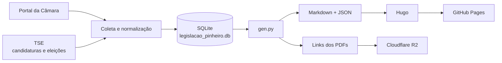

<p align="center">
  
</p>

<h1 align="center">Leis de Pinheiro</h1>

<p align="center">
  Normas, proposições, sessões e votações da Câmara Municipal de Pinheiro (MA),<br>
  organizadas para consulta pública e leitura em linguagem simples.
</p>

<p align="center">
  <a href="https://leis.sivaldodavi.com.br/"><strong>Site</strong></a> ·
  <a href="https://leis.sivaldodavi.com.br/normas/">Leis</a> ·
  <a href="https://leis.sivaldodavi.com.br/proposicoes/">Proposições</a> ·
  <a href="https://leis.sivaldodavi.com.br/sessoes/">Sessões</a> ·
  <a href="https://leis.sivaldodavi.com.br/votacoes/">Votações</a> ·
  <a href="https://leis.sivaldodavi.com.br/vereadores/">Vereadores</a> ·
  <a href="https://leis.sivaldodavi.com.br/estatisticas/">Estatísticas</a>
</p>

<p align="center">
  <a href="https://github.com/sivaldodavi/leis/actions/workflows/pages.yml"></a>
  <a href="https://leis.sivaldodavi.com.br/"></a>
  
  
  
  
</p>

> [!IMPORTANT]
> Este é um projeto independente de organização e consulta de dados públicos. **Não é o site oficial da Câmara Municipal de Pinheiro.** Antes de citar uma lei, uma proposição ou um voto, confira a publicação na fonte oficial indicada em [Fontes e dados](https://leis.sivaldodavi.com.br/fontes-e-dados/).

---

## O que você encontra

| Área | Conteúdo |
| --- | --- |
| [Leis e atos](https://leis.sivaldodavi.com.br/normas/) | Normas municipais com ementa, situação, dispositivos e links para o PDF original |
| [Proposições](https://leis.sivaldodavi.com.br/proposicoes/) | Indicações, moções, requerimentos, projetos e emendas, com autoria e tramitação |
| [Sessões](https://leis.sivaldodavi.com.br/sessoes/) | Pauta, presença, mesa diretora e votações de cada sessão plenária |
| [Votações](https://leis.sivaldodavi.com.br/votacoes/) | Resultado e voto nominal de cada vereador |
| [Vereadores](https://leis.sivaldodavi.com.br/vereadores/) | Perfil, mandatos, produção legislativa, presença e votos |
| [Estatísticas](https://leis.sivaldodavi.com.br/estatisticas/) | Cruzamentos por tipo, ano, autor, partido, tema e resultado |
| [Como ler](https://leis.sivaldodavi.com.br/como-ler/) | Glossário e explicação dos verbos e expressões do processo legislativo |

## Números do acervo

Snapshot publicado em **26/11/2026**:

| Indicador | Total |
| --- | ---: |
| Normas | 108 |
| Dispositivos publicados | 1.252 |
| Proposições | 1.911 |
| Autores | 34 |
| Vereadores | 42 |
| Sessões plenárias | 246 |
| Presenças registradas | 3.205 |
| Matérias de sessão | 1.825 |
| Votações | 416 |
| Votos nominais | 5.441 |
| PDFs no Cloudflare R2 | 1.742 |

Período coberto: **27/03/2023 a 25/11/2026**.

## Como funciona



1. O banco SQLite reúne normas, dispositivos, proposições, autores, sessões, presenças, votações e votos.
2. O `gen.py` lê o banco e gera as páginas Markdown, os JSONs públicos e os índices de busca.
3. O Hugo transforma esse conteúdo no site estático.
4. O GitHub Actions executa o `gen.py`, constrói o site e publica no GitHub Pages.
5. Os PDFs ficam no Cloudflare R2 e são referenciados por URL pública; não entram no build nem no Git.

## Estrutura do repositório

```text
.
├── content/                  # páginas geradas e páginas editoriais
│   ├── normas/
│   ├── proposicoes/
│   ├── sessoes/
│   ├── vereadores/
│   └── ...
├── data/                     # JSONs consumidos pelo Hugo
├── layouts/                  # templates Hugo
├── static/                   # CSS, imagens, OG cards, fotos e JSONs públicos
├── db/
│   └── legislacao_pinheiro.db
├── gen.py                    # geração do site a partir do SQLite
├── og.py                     # geração dos cards Open Graph
├── docs/                     # documentação técnica
└── .github/workflows/pages.yml
```

Os PDFs **não** ficam no repositório. O acervo está no R2:

- proposições e normas: `https://pub-c9e7f83be13a4ced872b3bd4d04c075a.r2.dev/documentos/`
- relatórios de sessões: `https://pub-c9e7f83be13a4ced872b3bd4d04c075a.r2.dev/relatorios/`

## Documentação

| Documento | Para quê |
| --- | --- |
| [Arquitetura](docs/ARQUITETURA.md) | Componentes, fluxo de geração, banco, Hugo e publicação |
| [Dados](docs/DADOS.md) | Entidades, contagens, correspondências e limitações |
| [Fontes e método](docs/FONTES-E-METODO.md) | De onde vêm os dados, como são normalizados e tratados |
| [Como atualizar](docs/COMO-ATUALIZAR.md) | Atualizar banco, PDFs no R2, gerar e publicar |

## Rodando localmente

Requisitos: **Python 3.12+** e **Hugo Extended 0.154.5+**.

```bash
export LEIS_BASE="$PWD"
export LEIS_DB="$PWD/db/legislacao_pinheiro.db"

python3 gen.py
hugo server --minify
```

O `gen.py` reescreve as páginas geradas em `content/`, os JSONs em `data/` e as cópias públicas em `static/dados/`. Rode-o sempre que o banco mudar.

Para gerar apenas o site, sem regenerar o banco:

```bash
hugo --minify
```

## Publicação

O deploy é automático a cada push na `main`:

1. checkout do repositório;
2. execução do `gen.py` com o banco versionado;
3. build com Hugo Extended;
4. publicação do diretório `public/` no GitHub Pages.

O domínio `leis.sivaldodavi.com.br` está configurado no repositório, com HTTPS emitido pelo GitHub Pages. O site não usa Git LFS e não depende do VPS.

## Fontes e método

- **Câmara Municipal de Pinheiro**: normas, proposições, sessões, presenças, votações e relatórios em PDF.
- **TSE — dados abertos**: candidaturas, partidos, votos e situação eleitoral dos vereadores.
- **Normalização**: datas, tipos, nomes, partidos, slugs e relações entre matérias e proposições.
- **Correspondências**: matérias dos relatórios são ligadas a proposições existentes; o que não tem correspondência e tem ano válido vira proposição nova com origem registrada.
- **Qualidade**: decisões e pendências da migração ficam na tabela `observacao` do banco.

A coleta respeita limites de acesso e não contorna bloqueios. Para grandes volumes, o caminho correto é solicitar o acervo pelos canais oficiais ou pela Lei de Acesso à Informação.

## Limitações

- Os dados são um recorte do que estava disponível nas fontes até **25/11/2026**.
- Seis matérias com ano inválido ficaram fora de `proposicoes` e estão registradas como exceção.
- 155 proposições foram criadas a partir de matérias dos relatórios; duas autorias novas ficaram pendentes de revisão.
- A correspondência entre matérias e proposições é feita por regras e pode exigir conferência manual.
- 1.437 PDFs de proposições e normas estão linkados no site; os 300 relatórios de sessões estão no R2, mas não são referenciados nas telas.
- O projeto não substitui a publicação oficial nem o Diário Oficial.

## Créditos

Feito por **Sivaldo Davi** · [@sivaldodavi.politica](https://www.instagram.com/sivaldodavi.politica/) no Instagram.

Dados públicos da Câmara Municipal de Pinheiro e do TSE. Site construído com Hugo, Python, SQLite, GitHub Pages e Cloudflare R2.
