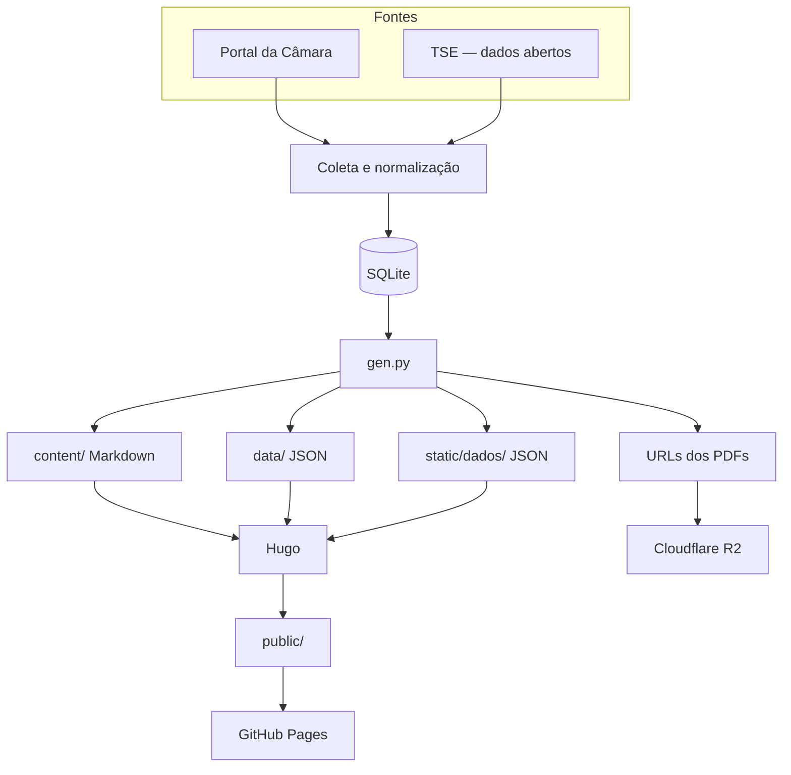

# Arquitetura

## Visão geral

O projeto é um site estático gerado a partir de um banco SQLite. Não há backend em produção: o GitHub Pages serve HTML, CSS, imagens e JSONs estáticos; os PDFs são servidos pelo Cloudflare R2.



## Componentes

| Componente | Papel |
| --- | --- |
| `db/legislacao_pinheiro.db` | Fonte estruturada de normas, dispositivos, proposições, autores, sessões, presenças, votações e votos |
| `gen.py` | Lê o SQLite e gera páginas, JSONs, índices de busca e links de PDF |
| `content/` | Páginas Markdown editoriais e geradas |
| `data/` | Dados consumidos pelos templates Hugo |
| `layouts/` | Templates do site |
| `static/` | CSS, imagens, fotos, cards Open Graph e JSONs públicos em `static/dados/` |
| `og.py` | Geração dos cards Open Graph a partir de fotos e metadados |
| `.github/workflows/pages.yml` | Pipeline de geração, build e publicação |
| Cloudflare R2 | Armazenamento e entrega dos PDFs |

## Fluxo de geração

1. O `gen.py` abre o banco em `LEIS_DB` e usa `LEIS_BASE` como raiz de saída.
2. Normas e dispositivos são lidos e transformados em páginas Markdown.
3. Proposições, autores, sessões, presenças, votações e votos são cruzados.
4. O script escreve:
   - `content/normas/*.md`
   - `content/proposicoes/*.md`
   - `content/sessoes/*.md`
   - `content/vereadores/*.md`
   - `content/votacoes.md`, `content/estatisticas.md`, `content/glossario.md`, `content/como-ler.md`
   - `data/*.json`
   - `static/dados/*.json`
5. O Hugo lê `content/`, `data/`, `layouts/` e `static/` e gera `public/`.
6. O GitHub Actions publica `public/` no Pages.

O `gen.py` é idempotente: pode ser executado novamente sobre o mesmo banco. Páginas geradas são recriadas; páginas editoriais não são apagadas.

## Modelo de dados

As tabelas principais do banco são:

| Tabela | Conteúdo |
| --- | --- |
| `normas` | Leis, decretos, resoluções, portarias e demais atos |
| `dispositivos` | Artigos, parágrafos, incisos e itens das normas |
| `proposicoes` | Indicações, moções, requerimentos, projetos, emendas e proposições correlatas |
| `autores` | Pessoas e órgãos que assinam proposições |
| `proposicao_autor` | Relação entre proposição e autoria |
| `materia` | Matérias registradas nos relatórios das sessões |
| `materia_proposicao` | Correspondência entre matéria de sessão e proposição |
| `materia_autor`, `materia_destinatario` | Autores e destinatários das matérias |
| `sessao` | Sessões plenárias, data, tipo e número |
| `presenca` | Presença de cada vereador por sessão |
| `votacao` | Votações realizadas nas sessões |
| `voto` | Voto nominal de cada vereador em cada votação |
| `vereador`, `vereador_autor` | Perfis de vereadores e vínculo com autores |
| `observacao` | Decisões, exceções, pendências e limitações da base |
| `fontes`, `arquivo_origem` | Rastreabilidade dos arquivos e origens |

O banco mantém índices de busca textual (`busca_dispositivos*`) e tabelas de normalização de nomes e partidos.

## Geração de URLs

O `gen.py` monta os links dos documentos a partir de `PDF_BASE`:

```python
PDF_BASE = "https://pub-c9e7f83be13a4ced872b3bd4d04c075a.r2.dev/documentos"
```

O caminho relativo vem do campo `arquivo_pdf` da proposição ou do arquivo fonte da norma. Exemplo:

```text
mocoes/MOC_059_2026.pdf
→ https://pub-c9e7f83be13a4ced872b3bd4d04c075a.r2.dev/documentos/mocoes/MOC_059_2026.pdf
```

Os 300 relatórios de sessões ficam em outra base:

```text
https://pub-c9e7f83be13a4ced872b3bd4d04c075a.r2.dev/relatorios/relatorio_N.pdf
```

## Build e publicação

O workflow `.github/workflows/pages.yml`:

1. baixa o repositório;
2. instala Python 3.12;
3. executa `python3 gen.py` com `LEIS_BASE` e `LEIS_DB` apontando para o checkout;
4. configura o Pages;
5. instala Hugo Extended 0.154.5;
6. executa `hugo --minify`;
7. envia `public/` como artefato;
8. publica no ambiente `github-pages`.

O domínio personalizado `leis.sivaldodavi.com.br` é configurado no repositório; o HTTPS é emitido pelo GitHub Pages. O PDF não entra no checkout do build.

## Decisões de arquitetura

- **Banco único**: o site usa um só SQLite, inclusive para sessões e votações.
- **PDF fora do Git**: o repositório guarda apenas dados e código; o acervo documental fica no R2.
- **Sem LFS**: não há dependência de Git LFS no build.
- **Sem backend**: todos os filtros e páginas de votações são resolvidos no navegador a partir dos JSONs estáticos.
- **Rastreabilidade**: decisões da migração ficam em `observacao`, em vez de comentários soltos no código.

## Limites operacionais

- O build depende do banco versionado; mudanças no banco exigem novo commit.
- O site não consulta a Câmara em tempo real.
- PDFs no R2 são públicos; a disponibilidade depende da configuração do bucket e da URL pública.
- A base é um recorte temporal e não substitui a publicação oficial.
